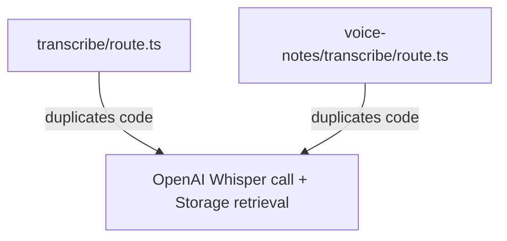

# Project Architecture Analysis & Refactoring Report
**Project:** TRANSCRIPT AI · PSY  
**Context:** AI-workspace for practicing psychologists (single-user deployment).  
**Date:** June 27, 2026  

---

## 1. Project Structure & Architecture Overview

The project is built on Next.js 15 (App Router) using React 19, TypeScript 5, Tailwind CSS, Supabase (for database/storage), and OpenAI APIs.

```
Browser
  ├── Next.js App Router (Page SSR / Client Components)
  └── Next.js Route Handlers (app/api/)
        ├── lib/data/ (Data Access Layer - DAL)
        │     ├── Supabase (Production DB / Storage)
        │     └── lib/*Store.ts (JSON Fallback DB - Development)
        └── OpenAI / Supabase API Client
```

### Architectural Tiers:
* **Frontend (`app/` and `components/`):** Next.js App Router. Server Components fetch data directly using the server-only DAL (`lib/data/*.ts`). Client components (`"use client"`) manage view state and issue requests to API routes.
* **Backend API (`app/api/`):** Purely serverless Next.js Route Handlers. Heavy operations (transcription, Whisper, FFmpeg, GPT analysis) are structured here.
* **Data Access Layer (`lib/data/`):** Houses queries and mutations. The data layer features a conditional hybrid approach: if Supabase configuration environment variables are set, it queries Supabase; otherwise, it falls back to writing local JSON files.
* **AI Engine & Knowledge Base (`lib/analysisService.ts`, `lib/evidenceService.ts`, `knowledge_base/`):** Employs prompt engineering based on raw text files in `knowledge_base/`. Long sessions use map-reduce compression logic before sending text to `gpt-4o`.

---

## 2. Technical Risks

### Critical Security Risks
> [!CAUTION]
> **No Authentication / Complete RLS Bypass**
> The application lacks any authentication layer (sign-in or token validation) on either frontend routes or backend APIs. 
> Furthermore, the Supabase client inside the DAL uses the `SUPABASE_SERVICE_ROLE_KEY` directly, completely bypassing Row-Level Security (RLS). If this app is deployed to a public URL (e.g., on Railway) without external protections (such as Basic Auth or IP restriction), **anyone can read, modify, or delete sensitive patient data and audio transcripts.**

### Database Schema Drift
> [!WARNING]
> **Manual Migrations and Field Mismatches**
> 1. There is no automated database migration tool (such as Prisma, Supabase CLI automation, or Knex). Migrations are manual copy-pastes into the Supabase SQL editor.
> 2. `voiceNotes.ts` reads/writes the database column `audio_deleted`. However, this column is completely missing from `supabase/schema.sql` and the migrations, resulting in runtime fallback logic.
> 3. The `archived_at` column is missing from the database, meaning the consultation archive feature is currently impossible to implement without a schema update.

### Performance & Operational Risks
* **No Transcription Request Throttling / Double-triggers:** There is no atomic lock to prevent two concurrent transcription calls on the same consultation. This could lead to duplicate OpenAI API billing charges and race conditions while writing transcript results to the database.
* **Ephemeral File Systems:** FFmpeg compression stores temporary files under `/tmp/`. Platforms like Railway have ephemeral filesystems. High concurrent traffic or large audio files could exhaust `/tmp/` space and cause server crashes.
* **Zero Test Coverage:** No unit or integration testing is configured. Making changes to transcription segment logic or LLM parsing risks silent regressions.

---

## 3. Coupling Analysis

### Hybrid Storage Coupling
The DAL (`lib/data/*.ts`) is tightly coupled to both Supabase and a custom JSON filesystem database. 
```typescript
if (isSupabaseConfigured()) {
  // Supabase implementation
} else {
  // JSON implementation
}
```
* **Why this is bad:** Adding a database field requires updating the database schema, the Supabase row mapper, the JSON interface, the JSON persistence file, and the JSON mock data.
* **Feature parity fragmentation:** Newer features like `clientRequests.ts` and `chatMessages.ts` do not implement the local JSON fallback. If the database is not configured, these features will crash, rendering the fallback system incomplete.

### Prompts Coupled to File Names
`lib/knowledgeBase.ts` resolves prompts by scanning files with strict numeric prefixes (e.g. `01–11_*.md`). This hardcoding of folder pattern parsing prevents developer flexibility in organizing, renaming, or decomposing prompt segments.

### Monolithic UI Components
* **`RealConsultationView.tsx` (~909 lines):** Houses layouts, audio controls, state management, analysis tab rendering, and action drawers.
* **`TranscriptPanel.tsx` (~780 lines):** Houses virtual scrolling, speech formatting, timestamp adjustments, search index calculations, and UI modals.
* **Why this is bad:** High complexity, difficult to maintain, and prone to type-checking issues during edits.

---

## 4. Duplicated Logic

### 1. Whisper Transcription Code
Both `/api/transcribe/route.ts` and `/api/voice-notes/transcribe/route.ts` duplicate the logic for resolving local file streams vs. downloading a file buffer from Supabase Storage and calling `openai.audio.transcriptions.create`.


### 2. JSON Store File Operations
Each helper store file under `lib/*Store.ts` repeats boilerplate code for:
* Opening, reading, and parsing a JSON file using `fs/promises`.
* Creating directories recursively.
* Writing back JSON strings.

---

## 5. AI-Agent Readiness

"AI-Agent Readiness" measures how safely and efficiently autonomous coding agents (like Claude Code, Gemini Antigravity, or Devin) can interact with, debug, and develop this project.

### Strengths (Agent-Friendly):
* **Excellent Documentation:** `project_state.md`, `NEXT_STEPS.md`, and `CLAUDE.md` provide clear documentation of what works, what doesn't, and the immediate project context.
* **Strict Type Safety:** The repository is fully written in TypeScript, helping agents find compiler errors immediately using `npx tsc --noEmit`.

### Weaknesses (Agent-Obstacles):
* **The Hybrid Store Overhead:** When asked to write a new feature, an agent must duplicate the logic across Supabase and the JSON fallback. This leads to longer context sizes, higher cost, and a higher probability of missing one of the implementations.
* **Lack of Tests:** Agents cannot write tests to verify their changes. They must rely on manual browser sub-agents or wait for user manual confirmation, slowing down the development loop.
* **Monolithic Components:** The size of components like `RealConsultationView.tsx` makes it hard to use search-and-replace tools without causing code syntax errors.

---

## 6. Recommended Refactoring Plan

We recommend a phased, low-risk refactoring plan that does not disrupt current feature sets.

### Phase 1: Security & Stability (Highest Priority)
1. **Implement API Route Protection:**
   Introduce a simple authorization header check (e.g. comparing a shared secret `API_KEY` stored in env variables) or integrate Basic Auth middleware for page views, since the app is single-user.
2. **Execute Database Cleanup Migrations:**
   * Write and execute a migration to add `audio_deleted` to the `voice_notes` table.
   * Write and execute a migration to add `archived_at` to the `consultations` table.
3. **Consolidate Audio & Transcription Logic:**
   Extract duplicate Whisper and Storage retrieval code from route handlers into a reusable utility file: `lib/audio/whisperService.ts`.

### Phase 2: Decoupling Storage & Prompts (Medium Priority)
1. **Refactor the DAL to a Repository Pattern:**
   Define a unified data interface (e.g. `ClientRepository`, `ConsultationRepository`). Move the JSON fallback and Supabase logic into discrete adapter classes rather than splitting inside every file with `if (isSupabaseConfigured())`.
2. **Decouple the JSON Fallback System:**
   * Either complete the JSON fallback for `clientRequests` and `chatMessages` to ensure project completeness in local-only environments.
   * Alternatively, declare Supabase as a hard requirement for all environments and deprecate the local JSON fallback code entirely, removing ~10 source files and simplifying the codebase by 30%.
3. **Decouple the Prompt Loader:**
   Refactor `knowledgeBase.ts` to look up prompts via an explicit configuration map rather than guessing based on file name prefixes.

### Phase 3: Component Decomposition (Low Priority)
1. **Deconstruct `RealConsultationView.tsx`:**
   Split this file into:
   * `components/consultation/ConsultationLayout.tsx` (handles columns, collapse states).
   * `components/consultation/AnalysisTabs.tsx` (handles analysis tab switches and refresh triggers).
   * `components/consultation/AudioPlayerSection.tsx` (handles media control and seeking).
2. **Deconstruct `TranscriptPanel.tsx`:**
   Extract custom search indices and formatting sub-components into separate file modules.

### Phase 4: Test Infrastructure Setup
1. Setup Vitest or Jest.
2. Write unit tests for critical business services: `evidenceService.ts` and `analysisService.ts`.
