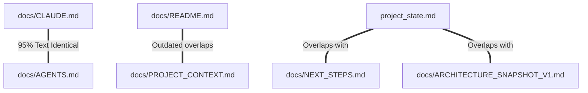

# Documentation Audit Report: TRANSCRIPT AI · PSY
**Context:** Documentation structure review for the AI-assisted workspace for practicing psychologists.  
**Date:** June 27, 2026  

---

## 1. Executive Summary

An audit of the project documentation (located in the root, `docs/`, and `docs/architecture/` folders) reveals a significant volume of documentation (18 separate files totaling ~160KB). While the documents contain high-quality context, they suffer from **severe duplication**, **internal contradictions**, **outdated architectural descriptions**, and a **typographical bug** in a core file name.

This audit details these issues and proposes a consolidated, modular documentation architecture designed to keep both human developers and AI coding agents aligned with zero friction.

---

## 2. Key Findings: Overlaps & Redundancies

The most prominent issue is that documents are copied and edited in fragments, creating multiple sources of truth.



* **`CLAUDE.md` vs. `AGENTS.md` (95% Duplicate):**  
  `docs/AGENTS.md` contains the exact same text, headers, and rules as `docs/CLAUDE.md` from lines 1 to 466. The only difference is that `AGENTS.md` appends a 40-line section defining agent roles (Claude Code, Codex, Antigravity) at the bottom.
* **`README.md` vs. `PROJECT_CONTEХT.md` vs. `02_AI_ARCHITECTURE.md`:**  
  The descriptions of the 4 primary analysis modes (`working`, `deep`, `therapist_process`, `gestalt`) are repeated across all three documents.
* **`project_state.md` vs. `docs/ARCHITECTURE_SNAPSHOT_V1.md`:**  
  Both files try to act as the comprehensive snapshot of "what was completed in the latest session." They duplicate descriptions of the `AnalysisEvidence` types, DB columns, and pipeline logic.

---

## 3. Contradictions & Outdated Information

Due to the project's evolution from a local JSON database to a Supabase cloud database, several core documents are now highly misleading.

### The Supabase Contradiction
Within `docs/CLAUDE.md` (and consequently `docs/AGENTS.md`), we find direct contradictions:
* **The Override (Top of File):**
  > *"Supabase уже подключён и работает в production. Фраза 'Do not connect Supabase yet' в разделе Data Storage ниже — устарела."*
* **The Outdated Rule (Under "Things NOT To Do"):**
  > *"Do not connect Supabase until the core workflow is stable."*
* **The Outdated Rule (Under "Data Storage"):**
  > *"Do not connect Supabase yet."*

### Outdated Stack & Feature Statuses

| Document | Outdated Statement | Current Reality |
|---|---|---|
| **`docs/README.md`** | *"MVP в разработке. Транскрипция (Whisper) и чат с AI — следующие этапы."* | Whisper transcription, chat history in DB, and segmented transcripts are fully implemented and running in production. |
| **`docs/README.md`** | Describes data storage solely using local `data/consultations.json` and local audio uploads. | The app has migrated to Supabase DB and Supabase Storage; local files are only a fallback. |
| **`docs/PROJECT_CONTEХT.md`**| States that the stack is based on local JSON/mockData, Whisper is planned, and Supabase is not connected. | Whisper and Supabase are fully connected and active. |
| **`docs/ARCHITECTURE.md`** | Lists stack storage as "Railway Volumes (`/data` persistent disk)" and AI as "Anthropic Claude API". | Storage is Supabase; the primary AI provider is OpenAI `gpt-4o`. Anthropic is a mock implementation. |
| **`docs/architecture/05_REQUEST_HISTORY.md`** | *"Статус: спроектировано, не реализовано. Целевая версия: v2."* | Request History is fully implemented (via migration 008, 009, 010 and `clientRequests.ts` DAL). |

---

## 4. Missing Documentation & Bugs

* **Typographical Filename Bug (Cyrillic Character):**  
  The file named `docs/PROJECT_CONTEХT.md` is spelled with a Cyrillic **'Х'** (Unicode `U+0425`, Cyrillic Capital Letter Ha) instead of a Latin **'X'** (Unicode `U+0058`). This prevents standard shell scripts and developers from finding the file via simple ASCII searches and causes broken links in cross-document references.
* **Missing Supabase Setup/Migration Guide:**  
  There is no documentation explaining how to spin up the Supabase database, how to set up the storage buckets (`audio`, `voice-notes`, `materials`), or how to bootstrap migrations (002-010) onto a clean database.
* **Missing API Documentation:**  
  While `docs/ARCHITECTURE.md` lists the original local API endpoints, it does not describe the payloads and parameters of the newer production routes (`/api/evidence/`, `/api/format-transcript/`, `/api/consultations/[id]/chat`, etc.).

---

## 5. Proposed Documentation Architecture

To eliminate redundancies and keep developers (humans and agents) aligned, we propose consolidating the 18 files into **5 core documents** organized by purpose and update frequency.

```
Root / docs/
  ├── README.md                 (Static: Quickstart & Setup Guide)
  ├── DEVELOPER_GUIDELINES.md   (Static: Coding standards, UI rules, Agent roles)
  ├── PROJECT_STATE.md          (Dynamic: Re-entry context, current build, DB schema)
  ├── NEXT_STEPS.md             (Dynamic: Active product backlog)
  └── docs/architecture/        (Static: Deep-dive modular reference guides)
        ├── 00_OVERVIEW.md      (Unified map: folders, schema, API routes)
        ├── 01_VISION.md
        ├── 02_AI_ENGINE.md
        └── ... (other design docs updated to show correct 'Implemented' status)
```

### 1. `README.md` (Static - External Entrypoint)
* **Purpose:** Quickstart guide for humans and onboarding tools.
* **Content:** Product description, stack (Next.js + Supabase + OpenAI), environment setup (`.env.local`), local launch instructions (`npm run dev`), deployment commands.
* **Action:** Delete outdated references to JSON-only databases; add Supabase environment variables and bucket configuration instructions.

### 2. `DEVELOPER_GUIDELINES.md` (Static - General Rules)
* **Purpose:** Core styling and coding standards. Consolidates `CLAUDE.md`, `AGENTS.md`, and `QA.md`.
* **Content:** 
  * Layout and scrolling rules (e.g., `h-screen`, independent columns, no page-scroll).
  * Agent instructions and tool-calling boundaries (Claude Code vs. Codex vs. Antigravity roles).
  * QA auditing checklist and rubric format.

### 3. `PROJECT_STATE.md` (Dynamic - Session Re-entry Point)
* **Purpose:** The single source of truth for the codebase status.
* **Content:** Currently active database schemas, configuration flags, working features list, incomplete features list, environment variable definitions.
* **Action:** Retain as the primary re-entry point file in the root.

### 4. `NEXT_STEPS.md` (Dynamic - Active Backlog)
* **Purpose:** Task list.
* **Content:** Backlog prioritized by P0, P1, P2.
* **Action:** Sync directly with `PROJECT_STATE.md` tasks and remove completed database migrations from the checklist.

### 5. `docs/architecture/` (Static - Technical Deep-dives)
* **Action plan:**
  1. Rename `docs/PROJECT_CONTEХT.md` to fix the Cyrillic 'Х' character, then merge its relevant layout vision into `DEVELOPER_GUIDELINES.md` and delete the old file.
  2. Merge the outdated `docs/ARCHITECTURE.md` and the verbose `docs/ARCHITECTURE_SNAPSHOT_V1.md` into a single, clean `docs/architecture/00_OVERVIEW.md` that maps out the folders, API endpoints, and Supabase tables.
  3. Update `05_REQUEST_HISTORY.md` to change its status from "planned/not implemented" to "implemented."
